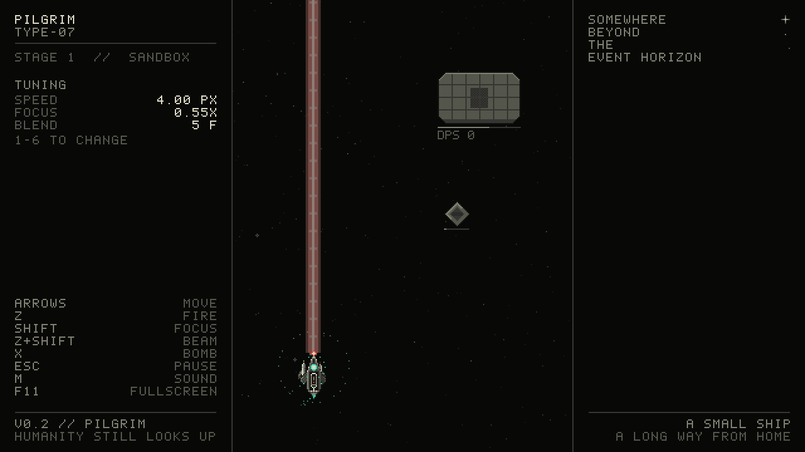

# PILGRIM


> SOMEWHERE BEYOND THE EVENT HORIZON. A SMALL SHIP, A LONG WAY FROM HOME.

A vertical bullet-hell shmup: Stage 1 and its boss, built sprint by sprint.
You fly the TYPE-07 "PILGRIM" toward a black hole.

**[▶ Play in your browser](https://bananalorian.github.io/macroshmup/)** ·
**[Download for Windows, macOS, Linux](https://github.com/Bananalorian/macroshmup/releases/latest)** ·
[Changelog](CHANGELOG.md) · [Sprint plan](SPRINTS.md)

Everything is generated in code. There are no asset files: the ship, the sprites,
the font and every sound are built when the game starts. Written in Rust on
[macroquad](https://macroquad.rs).

| | |
|---|---|
|  |  |
|  |  |


## Status

**v0.2, The Pilgrim:** the ship flies, shoots and beams at three target dummies,
with keyboard, controller (with rumble) and touch. Nothing shoots back yet; that's
v0.3. See [SPRINTS.md](SPRINTS.md) for the plan.

## Controls

| | Keyboard | Controller | Touch |
|---|---|---|---|
| Move | arrows or WASD | D-pad or left stick | drag anywhere |
| Fire | Z | A | automatic while you steer |
| Focus (slow + beam) | Shift | RB or RT | a second finger |
| Bomb (arrives in v0.5) | X | B | BOMB button |
| Pause and tuning | Esc | Start | II button |
| Sound on/off | M | | |
| Fullscreen | F11 or Alt+Enter | | |

The pause menu is also the tuning panel: speed, focus ratio, blend frames, touch
sensitivity, 8-way or analog stick, and rumble (off, low, full). On a keyboard,
1 to 6 change speed, focus and blend while you fly. Everything is saved.

## Build

```sh
cargo run --release                              # desktop
cargo test                                       # sim tests, headless (also run in CI)
rustup target add wasm32-unknown-unknown         # once
cargo build --release --target wasm32-unknown-unknown
python build_web.py                              # -> dist/index.html  (python3 on macOS/Linux)
```

Rust is pinned to 1.91.1 in `rust-toolchain.toml`, the same version CI uses.

### Debug hooks (native)

| Hook | What it does |
|---|---|
| `PG_SCENE=title` / `stage:<seconds>` / `shots:<n>` | jump straight there (`shots`: keep n player shots alive) |
| `PG_SHOTS=60,300` | save those frames to `./shots/` and quit |
| `PG_AUTO=1` | the autopilot flies, fires and beams |
| `PG_SEED=<n>` | fixed seed |
| `PG_GRAY=1` | grayscale screenshots (value check) |
| `PG_SIZE=1280x720` | window size |
| `PG_PERF=1` | the performance overlay (and a summary when a `PG_SHOTS` run ends) |
| `PG_SHEET=1` | save the ship's animation sheet to `./shots/` and quit |
| `PG_WAV=1` | dump every sound to `./shots/sfx/` |
| `PG_MENU=1` | open the pause menu |
| `PG_FRESH=1` | ignore the save file |

Debug builds: F1 hitboxes · F2 grayscale · F3 quarter speed · F4 frame step (Enter
resumes) · F8 performance overlay · F9 save the sprite sheet.

## Credits

Design and art direction by Jason Bartimus. Code by Claude Code. The setup, the font,
the synth, the controller code and the web shell come from
[Last Train to Shinjuku](https://github.com/Bananalorian/shinjuku).
Design rules from [Boghog's bullet hell shmup 101](https://shmups.wiki/library/Boghog%27s_bullet_hell_shmup_101).
